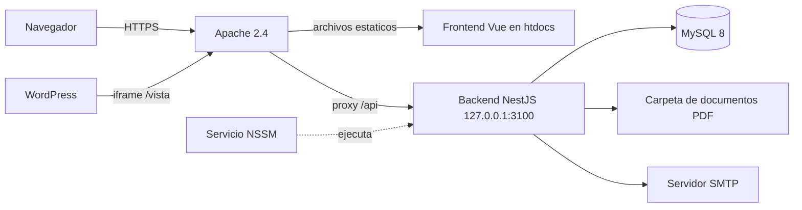
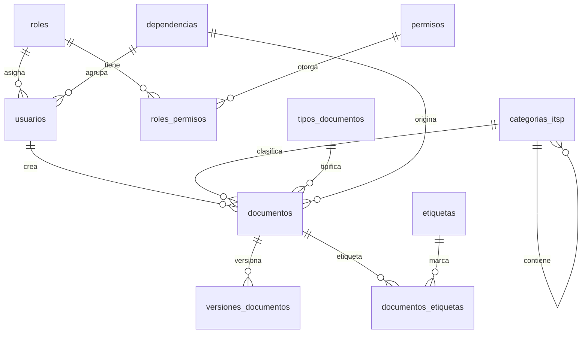
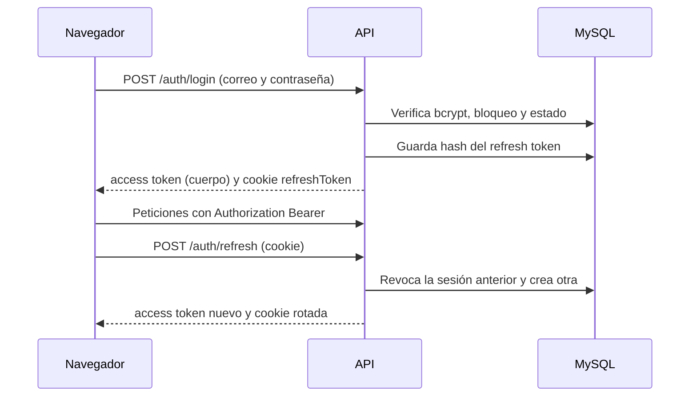
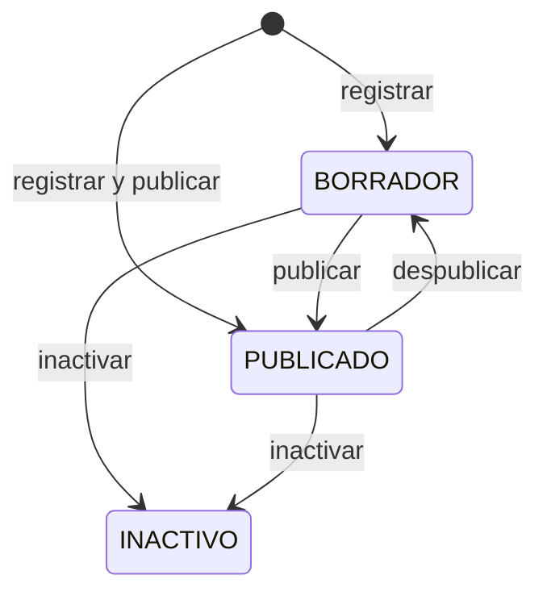

# Manual Técnico de Muni Data

| Campo | Valor |
|---|---|
| Sistema | Muni Data — Sistema Integral de Gestión Documental y Portal Web de Gobierno Abierto y Transparencia Municipal |
| Institución | Municipalidad de Palmares, Costa Rica |
| Versión | 1.0 |
| Fecha | 2026-11-02 |
| Autor | Gerald Huertas Rodríguez |
| Supervisor técnico y Product Owner | Lic. Joseph Miranda Vargas |
| Supervisor académico | MSc. Cristian Gerardo Herrera Alvarado |

| Versión | Fecha | Autor | Cambios |
|---|---|---|---|
| 1.0 | 2026-11-02 | Gerald Huertas Rodríguez | Versión inicial |

## 1. Introducción

### 1.1 Propósito y público

Este manual describe cómo está construido Muni Data y cómo se instala,
configura, opera y mantiene. Está dirigido a desarrolladores y al personal
de Tecnologías de Información que mantendrán el sistema sin ayuda del autor.
Toda la información sale del código de la rama `main`.

Muni Data se desarrolló como Práctica Profesional Supervisada (PPS) de la
Universidad Nacional de Costa Rica para la Municipalidad de Palmares.

### 1.2 Alcance

El sistema tiene dos partes:

- **Gestión documental interna** (con inicio de sesión): registro de
  documentos PDF con versiones, clasificación según la taxonomía del Índice
  de Transparencia del Sector Público (ITSP), publicación, catálogos,
  usuarios, roles, permisos, bitácora de auditoría e indicadores.
- **Portal público de transparencia** (sin inicio de sesión): las páginas
  bajo `/vista` que se incrustan en el sitio WordPress de la municipalidad
  y muestran los documentos publicados.

### 1.3 Actores y roles

Los roles del sistema se crean en `base-datos/scripts/init/02-datos-iniciales.sql`.

| Actor | Rol en el sistema | Acceso |
|---|---|---|
| Administración de TI | Superadministrador | Todo, incluidos usuarios, roles, permisos y bitácora |
| Funcionario municipal que gestiona documentos | Administrador | Documentos, versiones, catálogos e indicadores |
| Funcionario de consulta | Usuario | Consulta de documentos publicados |
| Ciudadanía y Defensoría de los Habitantes | Sin cuenta | Portal público |

### 1.4 Normativa de referencia

El sistema se diseñó tomando como referencia la normativa siguiente. No se
afirma ninguna certificación; el capítulo 11 relaciona cada control
implementado con la norma correspondiente.

| Norma | Aplicación en Muni Data |
|---|---|
| ISO/IEC 27001 | Control de acceso, registro de eventos, respaldos, mínimo privilegio |
| ISO/IEC 25010 | Mantenibilidad, seguridad y usabilidad como criterios de calidad |
| WCAG 2.1 AA | Contraste, foco visible, texto alternativo y navegación por teclado |
| Ley N.° 8968 | Protección de los datos personales de los usuarios |
| Normas N-2 / SEVRI (CGR) | Trazabilidad y gestión del riesgo en la información institucional |

## 2. Arquitectura general

### 2.1 Componentes



- Apache sirve el frontend compilado bajo `/munipalmares/wp-munidata/` y
  reenvía `/munipalmares/wp-munidata/api` al backend
  (`despliegue/apache/munidata.conf`).
- El backend escucha solo en `127.0.0.1:3100`; el único camino hacia la API
  es el proxy de Apache.
- El backend corre como servicio de Windows (`MuniData-API`) administrado
  con NSSM.
- Frontend y API comparten origen, por lo que no hay CORS en producción y la
  cookie `httpOnly` del refresh token funciona.

### 2.2 Stack y versiones

Versiones instaladas a la fecha de este manual (de `node_modules`):

| Capa | Tecnología | Versión |
|---|---|---|
| Entorno | Node.js | 22 (`engines: >=22`) |
| Backend | NestJS (`@nestjs/core`) | 11.2.1 |
| Backend | TypeORM / `mysql2` | 1.1.0 / 3.23.4 |
| Backend | TypeScript | 5.9.3 |
| Backend | `@nestjs/jwt` / `passport-jwt` | 11.0.2 / 4.0.1 |
| Backend | `bcrypt` / `nodemailer` | 6.0.0 / 9.1.1 |
| Backend | `@nestjs/throttler` / `@nestjs/schedule` | 6.5.0 / 6.1.3 |
| Backend | `pdf-lib` / Jest | 1.17.1 / 30.4.2 |
| Frontend | Vue / Vue Router | 3.5.43 / 5.3.0 |
| Frontend | Vite / Tailwind CSS | 8.2.1 / 4.3.3 |
| Frontend | TypeScript / `vue-tsc` | 6.0.3 / 3.3.10 |
| Frontend | Axios | 1.20.0 |
| Base de datos | MySQL (imagen `mysql:8.0` en desarrollo) | 8.0 |
| Servidor | Apache HTTP Server | 2.4 |

## 3. Estructura del repositorio

```text
backend/        API REST en NestJS
  src/          Módulos, entidades, guards, filtros y scripts
  test/         Prueba e2e de ejemplo
frontend/       Aplicación Vue 3 (sistema interno y portal público)
  public/       .htaccess, favicon.ico e iframes/ (snippets de WordPress)
  src/          types, services, composables, views, layouts, router, lib
base-datos/
  scripts/init/          Scripts SQL numerados del 01 al 10
  scripts/diagnostico/   Diagnóstico de solo lectura
  respaldos/             Carpeta para respaldos manuales (no versionada)
despliegue/     Scripts PowerShell, plantilla de Apache y DESPLIEGUE.md
documentacion/  Specs, sistema de diseño, integración con WordPress y manuales
docker-compose.yml   MySQL para desarrollo
.env.example         Plantilla del .env de desarrollo
```

> **Nota:** el `README.md` menciona una carpeta `docker/`, que no existe en
> el repositorio. La configuración de Docker es solo `docker-compose.yml`.

## 4. Entorno de desarrollo

### 4.1 Requisitos

- Windows 10 u 11 con PowerShell.
- Visual Studio Code (recomendado) con las extensiones de Vue y ESLint.
- Node.js 22 o superior y npm.
- Docker Desktop con Docker Compose (solo para MySQL).
- Git.

### 4.2 Base de datos con Docker

1. Copie la plantilla y complete los valores locales:

   ```powershell
   Copy-Item .env.example .env
   notepad .env
   ```

2. Levante MySQL. La primera vez, el contenedor ejecuta en orden alfabético
   todos los scripts de `base-datos/scripts/init/`:

   ```powershell
   docker compose up -d
   docker compose ps
   ```

3. Para reconstruir la base desde cero (borra el volumen `mysql_data`):

   ```powershell
   docker compose down -v
   docker compose up -d
   ```

> **Advertencia:** `docker compose down -v` borra todos los datos locales.
> No lo use si necesita conservar lo que cargó.

### 4.3 Backend

El backend lee el `.env` de la raíz del repositorio (`envFilePath: '../.env'`
en `backend/src/app.module.ts`).

```powershell
cd backend
npm install
npm run start:dev
```

Queda escuchando en el puerto de la variable `PUERTO` (3000 si no se define).
`GET /salud` responde sin sesión y sirve para comprobar que arrancó.

Scripts útiles de `backend/package.json`:

| Script | Uso |
|---|---|
| `npm run start:dev` | Desarrollo con recarga automática |
| `npm run build` | Compila a `dist/` |
| `npm test` | Pruebas unitarias con Jest |
| `npm run correo:verificar` | Prueba la conexión SMTP configurada |
| `npm run crear:administrador` | Crea el primer administrador (sobre `dist/`) |

> **Nota:** `npm run lint` ejecuta ESLint con `--fix` y modifica archivos.
> Para revisar sin cambiar nada, use `npx eslint` sobre archivos concretos.

### 4.4 Frontend

```powershell
cd frontend
npm install
npm run dev
```

Vite sirve en `http://localhost:5173`. Si no se define `VITE_URL_API`, el
cliente usa `http://localhost:3000` (`src/lib/http.ts`).

| Script | Uso |
|---|---|
| `npm run dev` | Servidor de desarrollo |
| `npm run build` | Verifica tipos con `vue-tsc` y compila a `dist/` |
| `npm run preview` | Sirve `dist/` para revisarlo |
| `npm run type-check` | Solo verificación de tipos |

### 4.5 Pruebas

- Backend: `npm test` en `backend/` (Jest; 17 suites y 296 pruebas a la
  fecha de este manual).
- Frontend: no tiene pruebas automáticas ni linter configurado; se verifica
  con `npm run build`, que incluye `vue-tsc`.

## 5. Configuración

Los valores no se documentan aquí. En desarrollo viven en `.env` (raíz) y en
producción en `C:\munidata\config\.env.produccion`, fuera del repositorio y
de `htdocs`. Las plantillas son `.env.example`,
`despliegue/.env.produccion.ejemplo` y `frontend/.env.example`.

### 5.1 Backend

| Variable | Propósito | Obligatoria |
|---|---|---|
| `NODE_ENV` | `production` activa cookie `secure` y desactiva Ethereal | En producción |
| `PUERTO` | Puerto local del backend (3100 en producción) | No (3000) |
| `HOST_ESCUCHA` | Interfaz de escucha; `127.0.0.1` en producción | En producción |
| `CONFIAR_EN_PROXY` | `true` para confiar en las cabeceras de Apache | En producción |
| `FRONTEND_URL` | URL pública del frontend; enlaces de correo y CORS | Sí |
| `BD_HOST`, `BD_PUERTO` | Servidor y puerto de MySQL | Sí |
| `BD_NOMBRE` | Nombre de la base | Sí |
| `BD_USUARIO`, `BD_CONTRASENA` | Cuenta de la aplicación (no `root`) | Sí |
| `JWT_ACCESS_SECRET` | Firma del access token | Sí |
| `JWT_REFRESH_SECRET` | Firma del refresh token | Sí |
| `JWT_ACCESS_EXPIRATION` | Vida del access token | No (`15m`) |
| `JWT_REFRESH_EXPIRATION` | Vida del refresh token | No (`8h`) |
| `BCRYPT_SALT_ROUNDS` | Rondas de bcrypt | No (12) |
| `LOGIN_MAX_INTENTOS` | Intentos fallidos antes del bloqueo | No (5) |
| `LOGIN_BLOQUEO_MINUTOS` | Duración del bloqueo | No (15) |
| `TOKEN_RECUPERACION_EXPIRACION_MIN` | Vigencia del enlace de recuperación | No (60) |
| `TOKEN_VERIFICACION_EXPIRACION_HORAS` | Vigencia del enlace de verificación | No (24) |
| `RUTA_ALMACENAMIENTO` | Carpeta de los PDF | No (`storage`) |
| `BITACORA_RETENCION_MESES` | Meses de bitácora; `0` desactiva la purga | No (3) |
| `SMTP_HOST`, `SMTP_PORT` | Servidor de correo saliente | En producción |
| `SMTP_USER`, `SMTP_PASS` | Cuenta del correo saliente | En producción |
| `SMTP_FROM` | Remitente; debe coincidir con `SMTP_USER` | En producción |

Variables solo de desarrollo, que usa `docker-compose.yml`: `MYSQL_ROOT_PASSWORD`,
`MYSQL_DATABASE`, `MYSQL_USER`, `MYSQL_PASSWORD` y `MYSQL_PORT`. El `.env.example`
incluye además `NOMBRE_APLICACION`, `ENTORNO` y `PUERTO_FRONTEND`, que el
código no lee.

> **Nota:** el backend acepta también `ALMACENAMIENTO_RUTA` como nombre
> anterior de `RUTA_ALMACENAMIENTO`; si están las dos, manda
> `RUTA_ALMACENAMIENTO`. El `.env.example` de la raíz no trae
> `RUTA_ALMACENAMIENTO`, `HOST_ESCUCHA` ni `CONFIAR_EN_PROXY`; están en la
> plantilla de producción.

El script `crear:administrador` lee además `ADMIN_CONTRASENA` (obligatoria),
`ADMIN_IDENTIFICACION` y `ADMIN_ROL`; `despliegue/crear-administrador.ps1`
las prepara.

### 5.2 Frontend

Las variables `VITE_*` viajan dentro del código que descarga el navegador:
nunca deben contener credenciales.

| Variable | Propósito | Producción |
|---|---|---|
| `VITE_RUTA_BASE` | Ruta pública del frontend, con barra final | `/munipalmares/wp-munidata/` |
| `VITE_URL_API` | Ruta de la API, sin barra final | `/munipalmares/wp-munidata/api` |
| `VITE_URL_PORTAL_PUBLICO` | Enlace «Abrir portal público» de Inicio; vacía lo oculta | Vacía |

`frontend/.env.production` se versiona a propósito porque solo contiene rutas
relativas. `VITE_RUTA_BASE` debe coincidir con el `RewriteBase` de
`frontend/public/.htaccess`.

## 6. Base de datos

### 6.1 Modelo



Además, `usuarios` se relaciona con `bitacora_logs`,
`sesiones_refresh_tokens`, `tokens_recuperacion_contrasena` y
`tokens_verificacion_correo`.

### 6.2 Tablas

| Tabla | Contenido |
|---|---|
| `roles` | Superadministrador, Administrador y Usuario |
| `permisos` | Permisos granulares (sección 7.4) |
| `roles_permisos` | Asignación N:M entre roles y permisos |
| `usuarios` | Cuentas, `contrasena_hash` (bcrypt), bloqueo, verificación de correo, rol y dependencia |
| `categorias_itsp` | Taxonomía ITSP; jerarquía por `id_categoria_padre`, hasta 10 niveles |
| `tipos_documentos` | Catálogo de tipos documentales |
| `dependencias` | Catálogo de dependencias municipales |
| `etiquetas` | Catálogo de palabras clave |
| `documentos` | Metadatos, estado y clasificación de cada documento |
| `versiones_documentos` | Cada PDF cargado: nombre en disco, ruta, hash, tamaño y páginas |
| `documentos_etiquetas` | Etiquetas de cada documento |
| `bitacora_logs` | Bitácora de auditoría; `detalles` es JSON |
| `sesiones_refresh_tokens` | Sesiones activas (hash del refresh token) |
| `tokens_recuperacion_contrasena` | Enlaces de un solo uso para restablecer contraseña |
| `tokens_verificacion_correo` | Enlaces de un solo uso para verificar el correo |

Los catálogos, documentos y usuarios tienen columna `estado`; nada de eso se
borra físicamente. `documentos.estado` admite `BORRADOR`, `PUBLICADO` e
`INACTIVO`. El tamaño máximo de un archivo también está limitado por un
`CHECK` en `versiones_documentos`.

### 6.3 Scripts y orden de ejecución

| Script | Contenido |
|---|---|
| `01-esquema.sql` | Tablas, claves, restricciones e índices |
| `02-datos-iniciales.sql` | Roles, permisos y asignaciones |
| `03-datos-itsp.sql` | Categorías raíz ITSP-01 a ITSP-04 |
| `04-alter-usuarios-auth.sql` | Bloqueo por intentos y verificación de correo |
| `05-tablas-sesiones-tokens.sql` | Sesiones y tokens de un solo uso |
| `06-usuario-superadministrador.sql` | Usuario semilla, **solo desarrollo** |
| `07-datos-catalogos-fase5.sql` | 30 tipos de documento |
| `08-ajuste-dependencia-y-paginas.sql` | Una dependencia por documento y usuario; `numero_paginas` |
| `09-permiso-reportes.sql` | Permiso `reportes.consultar` |
| `10-codigos-categorias-autogenerados.sql` | Códigos de categoría obligatorios y únicos |

- En desarrollo los ejecuta Docker la primera vez que se crea el volumen.
- En producción los aplica `despliegue/preparar-base-datos.ps1`, que quita
  las líneas `USE gestor_documental_pps;`, omite el `06` salvo que se pida
  con `-IncluirUsuarioSemilla`, y anota cada script aplicado en la tabla de
  control `scripts_aplicados`. Con `-SoloScripts` aplica solo los que falten.
- Un cambio de esquema nuevo se agrega como el siguiente número
  (`11-...sql`); los scripts existentes no se modifican.
- `base-datos/scripts/diagnostico/10-diagnostico-codigos-categorias.sql` es
  de solo lectura y lo usa `diagnosticar-codigos-categorias.ps1`.

### 6.4 Semillas

- Roles, permisos y asignaciones (02 y 09), cuatro categorías raíz (03) y
  treinta tipos de documento (07).
- El `06` crea un usuario semilla para el primer inicio de sesión en
  desarrollo. Sus datos están en `base-datos/scripts/README.md` y no se
  reproducen aquí. En producción el primer administrador se crea con
  `despliegue/crear-administrador.ps1`.

### 6.5 Sincronización del esquema

TypeORM trabaja con `synchronize: false` (`backend/src/app.module.ts`). El
esquema solo cambia mediante scripts SQL numerados; las entidades de
`backend/src/entidades/` deben reflejarlo a mano.

### 6.6 Retención de la bitácora

`backend/src/bitacora/bitacora-limpieza.service.ts` purga cada día 1 del mes
a las 03:00 (`0 3 1 * *`) los registros con más de `BITACORA_RETENCION_MESES`
meses (3 por defecto). El borrado es físico y queda registrado como
`PURGAR_BITACORA`. Con `0` la purga se desactiva.

> **Advertencia:** la purga no exporta antes de borrar. Si se necesita
> conservar un tramo, debe exportarse antes del día 1.

## 7. Backend

### 7.1 Módulos

| Módulo (`backend/src/`) | Responsabilidad |
|---|---|
| `autenticacion` | Inicio y cierre de sesión, renovación, verificación y recuperación |
| `usuarios` | Gestión de cuentas |
| `roles` | Roles y permisos |
| `catalogos` | Categorías ITSP, tipos, dependencias y etiquetas |
| `documentos` | Documentos, versiones, almacenamiento y descarga |
| `publico` | API del portal público |
| `reportes` | Indicadores de Inicio |
| `bitacora` | Registro, consulta y purga de la bitácora |
| `correo` | Envío de correos y plantillas |
| `salud` | Comprobación de funcionamiento |
| `comun` | Guards, decoradores, filtro de excepciones, caché de permisos |
| `configuracion` | Conexión a la base y origen de CORS |

### 7.2 Endpoints

Las rutas se escriben sin el prefijo público (`/munipalmares/wp-munidata/api`
en producción). «Sesión» significa que basta con estar autenticado.

Autenticación (`/auth`):

| Método | Ruta | Acceso | Descripción |
|---|---|---|---|
| POST | `/auth/login` | Público | Inicia sesión |
| POST | `/auth/refresh` | Público (cookie) | Renueva el access token |
| POST | `/auth/logout` | Sesión | Cierra la sesión |
| GET | `/auth/perfil` | Sesión | Datos y permisos del usuario |
| POST | `/auth/verificar-correo` | Público | Confirma el correo |
| POST | `/auth/verificar-correo/reenviar` | Público | Reenvía la verificación |
| POST | `/auth/recuperar-contrasena/solicitar` | Público | Envía el enlace de recuperación |
| POST | `/auth/recuperar-contrasena/confirmar` | Público | Fija la contraseña nueva |

Usuarios, roles y bitácora:

| Método | Ruta | Permiso | Descripción |
|---|---|---|---|
| GET | `/usuarios` | `usuarios.administrar` | Lista paginada |
| GET | `/usuarios/:id` | `usuarios.administrar` | Detalle |
| POST | `/usuarios` | `usuarios.administrar` | Crea un usuario |
| PATCH | `/usuarios/:id` | `usuarios.administrar` | Edita datos |
| PATCH | `/usuarios/:id/estado` | `usuarios.administrar` | Activa o inactiva |
| PATCH | `/usuarios/:id/rol` | `usuarios.administrar` | Cambia el rol |
| GET | `/roles` | Sesión | Lista de roles |
| GET | `/roles/:id/permisos` | Sesión | Permisos de un rol |
| PATCH | `/roles/:id/permisos` | Superadministrador | Cambia los permisos de un rol |
| GET | `/permisos` | Sesión | Catálogo de permisos |
| GET | `/bitacora` | `bitacora.consultar` | Consulta con filtros |

`PATCH /roles/:id/permisos` no usa un permiso granular: la restricción al rol
Superadministrador se valida dentro de `RolesService`.

Catálogos (permiso `catalogos.administrar` en todas las rutas):

| Método | Ruta | Descripción |
|---|---|---|
| GET | `/categorias-itsp` | Lista en orden de despliegue |
| GET | `/categorias-itsp/arbol` | Árbol anidado |
| GET | `/categorias-itsp/siguiente-codigo` | Código previsto para una nueva |
| GET | `/categorias-itsp/:id` | Detalle |
| POST | `/categorias-itsp` | Crea; el código lo asigna el sistema |
| PATCH | `/categorias-itsp/:id` | Edita o mueve con su subárbol |
| PATCH | `/categorias-itsp/:id/estado` | Activa o inactiva |

`/tipos-documentos`, `/dependencias` y `/etiquetas` exponen las mismas cinco
operaciones: `GET` (lista), `GET /:id`, `POST`, `PATCH /:id` y
`PATCH /:id/estado`.

Documentos:

| Método | Ruta | Permiso | Descripción |
|---|---|---|---|
| GET | `/documentos` | `documentos.consultar` | Lista con filtros |
| GET | `/documentos/:id` | `documentos.consultar` | Detalle |
| GET | `/documentos/:id/versiones` | `documentos.consultar` | Historial de versiones |
| POST | `/documentos` | `documentos.crear` | Registra documento y primera versión |
| PATCH | `/documentos/:id` | `documentos.editar` | Edita metadatos |
| PATCH | `/documentos/:id/publicar` | `documentos.publicar` | Publica |
| PATCH | `/documentos/:id/despublicar` | `documentos.publicar` | Vuelve a borrador |
| PATCH | `/documentos/:id/inactivar` | `documentos.inactivar` | Retiro lógico |
| POST | `/documentos/:id/versiones` | `versiones.cargar` | Carga una versión nueva |
| GET | `/documentos/:id/visualizar` | `documentos.consultar` | PDF en línea |
| GET | `/documentos/:id/descargar` | `documentos.consultar` | PDF como descarga |

Portal público, indicadores y salud:

| Método | Ruta | Acceso | Descripción |
|---|---|---|---|
| GET | `/publico/secciones` | Público | Secciones con subsecciones |
| GET | `/publico/secciones/:codigoSeccion` | Público | Una sección |
| GET | `/publico/secciones/:codigoSeccion/documentos` | Público | Documentos propios de la sección |
| GET | `/publico/secciones/:codigoSeccion/:codigoSubseccion/documentos` | Público | Documentos de una subsección |
| GET | `/publico/categorias/:codigo` | Público | Cualquier categoría visible |
| GET | `/publico/categorias/:codigo/documentos` | Público | Sus documentos propios |
| GET | `/publico/documentos/:id/visualizar` | Público | PDF publicado en línea |
| GET | `/publico/documentos/:id/descargar` | Público | PDF publicado como descarga |
| GET | `/reportes/resumen` | `reportes.consultar` | Registrados, del mes, publicados y pendientes |
| GET | `/reportes/por-categoria` | `reportes.consultar` | Documentos por categoría raíz |
| GET | `/reportes/por-dependencia` | `reportes.consultar` | Documentos por dependencia |
| GET | `/salud` | Público | Estado del servicio |

### 7.3 Autenticación



- **Access token:** JWT firmado con `JWT_ACCESS_SECRET`, 15 minutos por
  defecto. En el navegador vive solo en memoria (`frontend/src/lib/tokenStore.ts`),
  nunca en `localStorage`.
- **Refresh token:** cookie `refreshToken` con `httpOnly`, `sameSite: strict`,
  `secure` en producción y `path: /auth`. En la base solo se guarda su hash
  SHA-256 (`sesiones_refresh_tokens`). Cada renovación lo rota.
- **Expiración absoluta:** la sesión vence a las 8 horas del inicio de sesión
  aunque se renueve; la rotación conserva la fecha de expiración original.
- **Reutilización:** si llega un refresh token ya revocado, se revocan todas
  las sesiones activas de ese usuario (posible robo).
- **Bloqueo:** tras `LOGIN_MAX_INTENTOS` intentos fallidos la cuenta queda
  bloqueada `LOGIN_BLOQUEO_MINUTOS` minutos.
- **Contraseñas:** bcrypt con `BCRYPT_SALT_ROUNDS` rondas. La política exige
  al menos 8 caracteres, una mayúscula, un número y un símbolo.
- **Correo verificado:** el inicio de sesión exige el correo verificado. Los
  usuarios creados por un administrador nacen verificados.

### 7.4 Autorización (RBAC) y orden de los guards

Guards globales, en el orden de `backend/src/app.module.ts`:

1. `ThrottlerGuard`: 100 peticiones por minuto en general; 10 por minuto en
   `POST /auth/login`; 60 por minuto en las rutas JSON del portal y 20 en las
   de archivo.
2. `JwtAuthGuard`: exige un access token válido salvo en las rutas marcadas
   con `@Publico()`.
3. `PermisosGuard`: compara los permisos de `@RequierePermisos(...)` con los
   del rol del usuario. Los permisos por rol se cachean en
   `comun/cache/cache-permisos.service.ts`.

Permisos y asignación inicial:

| Permiso | Superadministrador | Administrador | Usuario |
|---|---|---|---|
| `documentos.crear` | Sí | Sí | No |
| `documentos.editar` | Sí | Sí | No |
| `documentos.publicar` | Sí | Sí | No |
| `documentos.inactivar` | Sí | Sí | No |
| `documentos.consultar` | Sí | Sí | Sí |
| `versiones.cargar` | Sí | Sí | No |
| `catalogos.administrar` | Sí | Sí | No |
| `usuarios.administrar` | Sí | No | No |
| `bitacora.consultar` | Sí | No | No |
| `reportes.consultar` | Sí | Sí | No |

El Superadministrador puede cambiar la asignación desde «Roles y Permisos».

`UsuarioActualService` (`comun/servicios/usuario-actual.service.ts`) y el
decorador `@UsuarioJwtActual()` entregan a los servicios el usuario
autenticado, que se usa en la bitácora y en reglas como la de
`PATCH /roles/:id/permisos`.

### 7.5 Validación y manejo de errores

- `ValidationPipe` global con `whitelist: true` (descarta propiedades no
  declaradas en el DTO) y `transform: true` (`backend/src/main.ts`).
- `ExcepcionGlobalFilter` (`comun/filtros/excepcion-global.filter.ts`)
  devuelve todas las respuestas de error con la misma forma: `statusCode`,
  `mensaje`, `error`, `timestamp` y `ruta`.
- Las excepciones de negocio están en `comun/excepciones/` y llevan su
  mensaje en español, que el frontend muestra tal cual.
- El portal usa `FiltroThrottlerPublico` para responder el exceso de
  peticiones con un mensaje propio.

### 7.6 Correo

`backend/src/correo/` envía dos correos con la plantilla institucional de
`plantillas-correo.ts`: verificación de correo y recuperación de contraseña.

| Situación | Comportamiento |
|---|---|
| `SMTP_HOST` definido | Envía por ese servidor; el puerto 587 usa STARTTLS |
| Sin `SMTP_HOST` fuera de producción | Usa una cuenta de prueba de Ethereal; nada llega a un buzón real |
| Sin `SMTP_HOST` en producción | El envío queda deshabilitado |

`npm run correo:verificar` prueba la conexión. Las credenciales nunca se
escriben en el código ni en los registros.

### 7.7 Bitácora

`BitacoraService.registrar` guarda usuario, acción, entidad, identificador,
resultado, IP de origen y `detalles` (JSON). Nunca registra contraseñas ni
tokens.

| Ámbito | Acciones |
|---|---|
| Sesión | `LOGIN_EXITOSO`, `LOGIN_FALLIDO`, `LOGOUT` |
| Usuarios | `CREAR_USUARIO`, `ACTUALIZAR_USUARIO`, `INACTIVAR_USUARIO`, `REACTIVAR_USUARIO`, `ASIGNAR_ROL_USUARIO` |
| Roles | `ACTUALIZAR_PERMISOS_ROL` |
| Documentos | `CREAR_DOCUMENTO`, `ACTUALIZAR_DOCUMENTO`, `PUBLICAR_DOCUMENTO`, `DESPUBLICAR_DOCUMENTO`, `INACTIVAR_DOCUMENTO` |
| Archivos | `CREAR_VERSION_DOCUMENTO`, `DESCARGAR_DOCUMENTO` |
| Catálogos | `CREAR_`, `ACTUALIZAR_`, `INACTIVAR_`, `REACTIVAR_` + `CATEGORIA_ITSP`, `TIPO_DOCUMENTO`, `DEPENDENCIA` o `ETIQUETA` |
| Mantenimiento | `PURGAR_BITACORA` |

Al mover una categoría, `detalles` guarda el código anterior, el nuevo, el
total de URL que cambian y hasta 100 pares de códigos de sus descendientes.

## 8. Gestión documental

### 8.1 Almacenamiento

- Los PDF se guardan en `RUTA_ALMACENAMIENTO` (por defecto `storage/` junto
  al backend), en la subcarpeta `documentos`, con un nombre UUID
  (`backend/src/documentos/almacenamiento-documentos.service.ts`).
- La carpeta está fuera de `htdocs`: un documento solo se obtiene a través
  de la API, que comprueba permisos y registra la descarga.
- La base guarda rutas relativas a esa raíz. Si se cambia la variable con
  documentos cargados, hay que mover antes la carpeta.

### 8.2 Validación del archivo

| Control | Regla |
|---|---|
| Tipo MIME | `application/pdf` |
| Firma | El contenido empieza por `%PDF-` |
| Tamaño | Hasta 40 MB (41 943 040 bytes), también como `CHECK` en la base |
| Integridad | Hash SHA-256 del contenido, guardado en `hash_archivo` |
| Páginas | Se cuentan con `pdf-lib`; si el PDF no se puede leer, quedan vacías |

La entrega usa `createReadStream` y `StreamableFile`: el archivo se transmite
en partes y no se carga entero en memoria.

### 8.3 Estados del documento



- `INACTIVO` es el retiro lógico definitivo: no se edita, no se publica y no
  admite versiones nuevas.
- Solo los documentos `PUBLICADO` aparecen en el portal, y solo si su
  categoría y todas sus superiores están activas.
- No existe borrado físico de documentos ni de versiones.

### 8.4 Clasificación

- Cada documento tiene una categoría ITSP, un tipo documental, una
  dependencia opcional y etiquetas opcionales; todos deben estar activos.
- Las categorías admiten hasta 10 niveles
  (`PROFUNDIDAD_MAXIMA_CATEGORIAS` en `comun/constantes/categorias-itsp.ts`).
- Ningún nodo del subárbol de Participación ciudadana (`ITSP-03`) admite
  documentos.
- El código de una categoría es el de su superior más `-NN`, asignado por el
  sistema. Mover una categoría recalcula los códigos de todo su subárbol en
  una transacción.

### 8.5 Versiones

`POST /documentos/:id/versiones` agrega una versión con su número
consecutivo; la anterior se conserva en `versiones_documentos`. Por defecto
se muestra y descarga la versión vigente. En el sistema interno,
`/documentos/:id/visualizar` y `/documentos/:id/descargar` aceptan
`?version=N` para obtener una anterior; el portal público entrega solo la
vigente.

## 9. Frontend

### 9.1 Estructura y patrón

Cada funcionalidad sigue el mismo flujo de capas en `frontend/src/`:

| Capa | Carpeta | Responsabilidad |
|---|---|---|
| Tipos | `types/` | Contratos de la API en TypeScript |
| Servicios | `services/` | Llamadas HTTP con Axios |
| Composables | `composables/` | Estado reactivo y lógica de cada pantalla |
| Vistas | `views/` | Pantallas |
| Utilidades | `lib/` | Configuración, validaciones, tema, cliente HTTP |

No se usa Pinia: el estado compartido (sesión, notificaciones, tema) vive en
composables con estado a nivel de módulo.

### 9.2 Router y layouts

- `src/router/index.ts` define tres grupos de rutas: públicas (login,
  recuperación y verificación), el portal (`/vista`, layout
  `PortalPublicoLayout.vue`) y el área autenticada (layout
  `AppShellLayout.vue`, con barra lateral).
- Las rutas con `meta.sinSesion` (portal) no intentan restaurar la sesión.
- Las rutas con `meta.permiso` redirigen a Inicio si falta el permiso. Es una
  barrera de interfaz: la autorización real la aplica el backend.
- La base del router es `import.meta.env.BASE_URL`, derivada de
  `VITE_RUTA_BASE`.

### 9.3 Sesión sin Pinia

- `lib/tokenStore.ts` guarda el access token en una variable de módulo.
- `lib/http.ts` añade el token a cada petición y, ante un 401, intenta una
  vez `POST /auth/refresh` antes de cerrar la sesión.
- `composables/useAutenticacion.ts` expone el usuario, sus permisos y
  `restaurarSesion()`, que el router llama tras recargar la página.
- El portal usa su propio cliente (`lib/httpPublico.ts`), que no toca la
  sesión.

### 9.4 Modo oscuro

- El tema del sistema interno se elige con el botón de la barra superior y se
  guarda por navegador en `localStorage` con la clave `munidata-tema`
  (`lib/tema.ts`, `composables/useTema.ts`).
- `index.html` aplica el tema y la «superficie» (`data-superficie`: `sistema`,
  `publica` o `portal`) antes de montar Vue, para evitar un destello.
- El portal público es siempre oscuro, con sus propias variables `--portal-*`.

### 9.5 Sistema de diseño

La referencia es `documentacion/design/DESIGN.md`; los tokens están en
`frontend/src/assets/main.css` (Tailwind CSS 4, bloque `@theme`).

| Elemento | Valor |
|---|---|
| Rojo de acción (`primary-container`) | #D30505 |
| Rojo principal (`primary`) | #A60001 |
| Gris estructural oscuro | #1D2327 |
| Gris de etiquetas y bordes | #ABADB3 |
| Superficie neutra | #FAFAFA |
| Tipografía del sistema | Public Sans |
| Tipografía del portal | Poppins (`@fontsource/poppins`) |

- **Botones:** primario rojo con texto blanco; secundario blanco con borde
  #1D2327; terciario sin fondo y subrayado.
- **Píldora:** en el sistema interno, la forma de píldora es exclusiva de las
  insignias de estado (`InsigniaEstado.vue`): Activo y Publicado en verde,
  Borrador en amarillo, Inactivo en rojo, siempre con su texto.
- **Portal:** replica el estilo del Observatorio Municipal de Datos; ahí los
  botones también son píldoras.

## 10. Portal público e integración con WordPress

### 10.1 Rutas

| Dirección | Vista | Contenido |
|---|---|---|
| `/vista` | `PortalSeccionesView.vue` | Secciones activas |
| `/vista/itsp-NN` | `PortalNodoView.vue` | Una sección |
| `/vista/itsp-NN/itsp-NN-NN` | `PortalNodoView.vue` | Una subsección de esa sección |
| `/vista/codigo` | `PortalNodoView.vue` | Cualquier categoría, de cualquier nivel |

- El código se acepta en mayúsculas o minúsculas.
- Cada página muestra las tarjetas de sus hijas activas, sus documentos
  publicados paginados (20 por página, máximo 50) o un aviso si no hay nada.
- Participación ciudadana y su subárbol muestran «Contenido próximamente».
- De cada documento se muestran título, descripción, año, fecha de
  publicación, tipo, dependencia, páginas, tamaño y etiquetas, con los
  botones Ver y Descargar.

### 10.2 Iframes en WordPress

- `frontend/public/iframes/` contiene un snippet por sección y la página de
  prueba `prueba-vista.html`.
- Cada página de WordPress del menú Transparencia lleva un bloque HTML
  personalizado con el `iframe` de su sección.
- El `.htaccess` permite el marco solo desde el mismo origen
  (`X-Frame-Options: SAMEORIGIN` y `frame-ancestors 'self'`).
- La guía paso a paso para el administrador de WordPress está en
  `documentacion/portal-publico/INTEGRACION-WORDPRESS.md`.

> **Advertencia:** mover una categoría cambia su código y el de su subárbol,
> y con ellos sus URL. Los enlaces de WordPress a esas categorías deben
> actualizarse.

## 11. Seguridad

| Control implementado | Dónde | Referencia |
|---|---|---|
| Autenticación con JWT y refresh rotado | `autenticacion/` | ISO 27001 A.9 |
| Expiración absoluta de 8 horas | `autenticacion.service.ts` | ISO 27001 A.9.4 |
| Bloqueo por intentos fallidos | `autenticacion.service.ts` | ISO 27001 A.9.4 |
| Contraseñas con bcrypt y política mínima | `usuarios/`, `autenticacion/` | ISO 27001 A.9.4 |
| RBAC con permisos granulares | `comun/guards/` | ISO 27001 A.9.2 |
| Límite de peticiones | `ThrottlerGuard` | ISO 27001 A.13 |
| Bitácora sin datos sensibles | `bitacora/` | ISO 27001 A.12.4 |
| Respaldos diarios con 14 días de retención | `respaldar.ps1` | ISO 27001 A.12.3 |
| Usuario de base de datos sin privilegios de `root` | `preparar-base-datos.ps1` | ISO 27001 A.9.2 |
| Backend solo en `127.0.0.1`, detrás de Apache | `munidata.conf`, `.env` | ISO 27001 A.13.1 |
| Cabeceras `nosniff`, `SAMEORIGIN`, CSP y `Referrer-Policy` | `frontend/public/.htaccess` | ISO 27001 A.14 |
| PDF validado y fuera de `htdocs` | `almacenamiento-documentos.service.ts` | ISO 27001 A.12.2 |
| Mínimo de datos personales y acceso restringido | `usuarios`, permisos | Ley N.° 8968 |
| Secretos fuera del repositorio | `.gitignore`, `.env.produccion` | ISO 27001 A.9.4 |

- La API pública solo devuelve documentos `PUBLICADO` en categorías
  efectivamente activas, sin autor, estado ni rutas internas.
- Los datos personales (nombre, identificación y correo) solo los ven
  quienes tienen `usuarios.administrar`.

## 12. Despliegue y operación

El procedimiento completo, con comandos y verificaciones, está en
`despliegue/DESPLIEGUE.md`. Este capítulo es un resumen.

### 12.1 Arquitectura del despliegue

| Elemento | Valor por defecto |
|---|---|
| Carpeta de datos | `C:\munidata` |
| Configuración | `C:\munidata\config\.env.produccion` |
| Servicio de Windows | `MuniData-API` (NSSM), puerto 3100 |
| Frontend publicado | `htdocs\munipalmares\wp-munidata` |
| Base de producción | `munidata`, usuario `munidata_app` |
| Respaldos | `C:\munidata\respaldos`, 14 conservados |

El servidor se identifica en los ejemplos como
`<IP_O_DOMINIO_DEL_SERVIDOR>`; la dirección real no se documenta aquí.

| Script (`despliegue/`) | Función |
|---|---|
| `verificar-requisitos.ps1` | Comprueba Node, NSSM, Apache, puerto y espacio |
| `preparar-base-datos.ps1` | Crea la base, el usuario y aplica los scripts |
| `desplegar.ps1` | Compila, publica el frontend e instala el servicio |
| `crear-administrador.ps1` | Crea el primer administrador |
| `verificar-despliegue.ps1` | Diez comprobaciones tras desplegar |
| `respaldar.ps1` | Respaldo de base y documentos; tarea programada |
| `revertir.ps1` | Vuelve a la versión anterior publicada |
| `diagnosticar-codigos-categorias.ps1` | Diagnóstico de solo lectura |

Todos admiten `-Simular`, que muestra lo que harían sin cambiar nada.

### 12.2 Redespliegue

El orden es siempre: respaldo, `git status` limpio, anotar el commit con
`git rev-parse HEAD`, `git pull`, aplicar scripts SQL nuevos con
`preparar-base-datos.ps1 -SoloScripts` (si los hay), `desplegar.ps1` y
`verificar-despliegue.ps1`.

- `desplegar.ps1` respalda lo publicado antes de reemplazarlo, y solo vacía
  la carpeta del frontend si tiene el marcador que dejó una publicación
  anterior de Muni Data.
- Copia `dist\*` completo y el `.htaccess` aparte.
- No toca la base de datos ni la carpeta de documentos.

> **Advertencia:** sin `-SoloScripts`, `preparar-base-datos.ps1` pide una
> contraseña nueva para `munidata_app` y la cambia. En una base en uso,
> utilice siempre `-SoloScripts`.

### 12.3 Respaldos y restauración

- `respaldar.ps1 -RegistrarTarea` programa un respaldo diario a las 02:30.
  Cada respaldo contiene `base-datos.sql.gz` y `documentos.zip`.
- La restauración de la base y de los documentos se describe en las
  secciones 8.2 y 8.3 de `DESPLIEGUE.md`.
- `revertir.ps1` restaura el backend y el frontend anteriores sin tocar la
  base.

## 13. Identidad visual

- El icono de la pestaña es `frontend/public/favicon.ico`: el monograma de
  Muni Data, una «M» blanca sobre #1D2327 con una barra roja, con cuadros de
  16×16 y 32×32.
- Se enlaza en `frontend/index.html` como
  `%BASE_URL%favicon.ico?v=2`; Vite le antepone la base al compilar.
- El título de la pestaña es «Muni Data — Municipalidad de Palmares».

Para reemplazarlo:

1. Sustituya `frontend/public/favicon.ico` conservando el nombre.
2. Suba el número de `?v=2` en `frontend/index.html` (por ejemplo, `?v=3`).
   El `.htaccess` sirve los `.ico` con caché de un año marcada como
   inmutable; sin cambiar la URL, los navegadores conservarían el anterior.
3. Compile, compruebe que `dist/favicon.ico` es el nuevo y redespliegue.

## 14. Decisiones de arquitectura

| Decisión | Justificación |
|---|---|
| Frontend y API bajo el mismo origen | Sin CORS en producción y cookie `httpOnly` funcional |
| Access token en memoria, refresh en cookie | Reduce la exposición ante XSS |
| `synchronize: false` y scripts numerados | Cambios de esquema controlados y auditables |
| Sin borrado físico de documentos | Trazabilidad y conservación documental |
| PDF fuera de `htdocs`, servidos por la API | Control de permisos y registro de descargas |
| Sin Pinia | El estado compartido es pequeño; los composables bastan |
| Códigos de categoría asignados por el sistema | Evita duplicados y mantiene URL predecibles |
| Portal con su propio cliente HTTP | El portal no puede tocar la sesión por error |
| Backend solo en `127.0.0.1` | La única puerta es Apache con HTTPS |
| Scripts de despliegue con `-Simular` | Permiten revisar cada paso antes de ejecutarlo |

Los detalles de cada decisión están en los specs de `documentacion/`.

## 15. Problemas frecuentes

| Síntoma | Causa probable | Solución |
|---|---|---|
| `502 Bad Gateway` | El servicio `MuniData-API` no está corriendo | Revise el servicio y su registro (`DESPLIEGUE.md` §10.1) |
| 404 al recargar una ruta | Falta `AllowOverride All` o el `.htaccess` | `DESPLIEGUE.md` §10.2 |
| La sesión no persiste al recargar | Cookie bloqueada por HTTP o ruta | Use HTTPS; `DESPLIEGUE.md` §10.3 |
| El servicio no arranca | Variables faltantes o puerto ocupado | `DESPLIEGUE.md` §10.4 y §10.7 |
| No salen correos | SMTP mal configurado | `npm run correo:verificar`; `DESPLIEGUE.md` §10.6 |
| Iframe en blanco | Se abrió por `http://` o la URL tiene errata | `INTEGRACION-WORDPRESS.md` |
| «Demasiadas solicitudes» | Límite de peticiones | Esperar un minuto |
| Sigue el icono anterior | Caché del navegador | Cerrar la pestaña o subir `?v=` (capítulo 13) |

## 16. Limitaciones conocidas y trabajo futuro

- **Interoperabilidad:** no existe integración con DECSA, SITRIMU ni
  Strategos.
- **Participación ciudadana:** la sección del portal no tiene contenido; se
  llena desde WordPress.
- **Bitácora:** no hay exportación antes de la purga mensual.
- **Bitácora:** al editar una categoría, `camposActualizados` incluye todos
  los campos que envía el formulario aunque no hayan cambiado.
- **Configuración:** el `.env.example` de la raíz no incluye
  `RUTA_ALMACENAMIENTO`, `HOST_ESCUCHA` ni `CONFIAR_EN_PROXY`.
- **Pruebas del frontend:** no hay pruebas automáticas ni linter.

## Anexo A. Glosario

| Término | Significado |
|---|---|
| Access token | Credencial de corta duración que acompaña cada petición |
| Bitácora | Registro de auditoría de las acciones del sistema |
| Categoría ITSP | Nodo de la taxonomía del Índice de Transparencia del Sector Público |
| CORS | Mecanismo del navegador para peticiones entre orígenes |
| DTO | Objeto que define y valida los datos de una petición |
| Guard | Componente de NestJS que decide si una petición continúa |
| JWT | Formato de token firmado (JSON Web Token) |
| NSSM | Herramienta que ejecuta un programa como servicio de Windows |
| RBAC | Control de acceso basado en roles |
| Refresh token | Credencial de larga duración para obtener access tokens nuevos |
| SHA-256 | Función hash usada para verificar la integridad de los archivos |
| SPA | Aplicación de una sola página; el router resuelve las rutas en el navegador |
| Subárbol | Una categoría con todas las que cuelgan de ella |
