# Manual de Usuario de Muni Data

| Campo | Valor |
|---|---|
| Sistema | Muni Data — Sistema Integral de Gestión Documental y Portal Web de Gobierno Abierto y Transparencia Municipal |
| Institución | Municipalidad de Palmares, Costa Rica |
| Versión | 1.0 |
| Fecha | 2026-11-02 |
| Autor | Gerald Huertas Rodríguez |
| Supervisor técnico y Product Owner | Lic. Joseph Miranda Vargas |
| Supervisor académico | MSc. Cristian Gerardo Herrera Alvarado |

| Versión | Fecha | Autor | Cambios |
|---|---|---|---|
| 1.0 | 2026-11-02 | Gerald Huertas Rodríguez | Versión inicial |

## 1. Introducción

### 1.1 Qué es Muni Data

Muni Data es el sistema de la Municipalidad de Palmares para guardar,
ordenar y publicar sus documentos institucionales. Con él usted puede:

- registrar documentos en PDF y conservar todas sus versiones;
- clasificarlos según el Índice de Transparencia del Sector Público (ITSP);
- publicarlos en el portal de transparencia del sitio web municipal;
- consultar quién hizo cada cambio, gracias a la bitácora.

### 1.2 A quién va dirigido

Este manual es para el personal municipal que usa el sistema: quienes
registran y publican documentos, quienes los consultan y quienes administran
usuarios y permisos. No necesita conocimientos técnicos.

> **Nota:** las imágenes de este manual se tomaron con datos de ejemplo. Los
> nombres, correos y documentos que aparecen son ficticios.

## 2. Requisitos e ingreso al sistema

### 2.1 Qué necesita

- Una computadora con un navegador actualizado: Google Chrome, Microsoft
  Edge o Mozilla Firefox.
- Conexión a internet o a la red municipal.
- Una cuenta creada por la persona administradora del sistema.

### 2.2 Cómo ingresar

1. Abra en el navegador la dirección de Muni Data que le indicó el
   Departamento de Tecnologías de la Información.
2. En **Correo Electrónico Institucional**, escriba su correo.
3. En **Contraseña**, escriba su contraseña. El icono del ojo permite ver lo
   que escribió.
4. Pulse **Iniciar Sesión**.

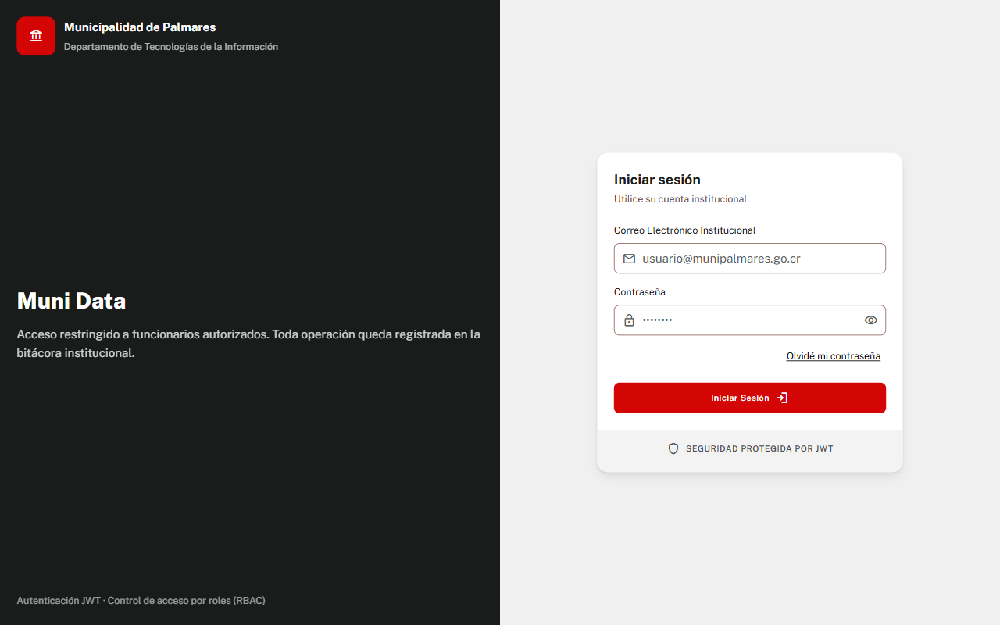

*Figura 1. Pantalla de inicio de sesión.*

> **Advertencia:** después de varios intentos fallidos seguidos, la cuenta se
> bloquea durante unos minutos por seguridad. Espere el tiempo que indica el
> mensaje antes de volver a intentarlo.

### 2.3 Si olvidó su contraseña

1. En la pantalla de inicio de sesión, pulse **Olvidé mi contraseña**.
2. Escriba su correo electrónico y pulse **Enviar enlace de recuperación**.
3. Revise su correo y abra el enlace que recibió. El enlace vence después de
   un tiempo; si venció, solicite otro.
4. Escriba la contraseña nueva. Debe tener al menos 8 caracteres, una
   mayúscula, un número y un carácter especial.

Para regresar sin cambiar nada, pulse **Volver al inicio de sesión**.

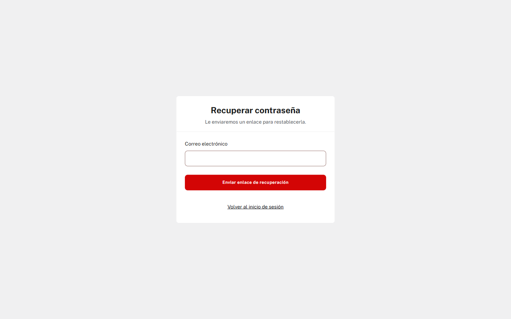

*Figura 2. Recuperación de contraseña.*

### 2.4 Duración de la sesión

Por seguridad, la sesión dura como máximo 8 horas desde que ingresó. Al
vencer, el sistema le pide ingresar de nuevo con el mensaje «Su sesión expiró
por seguridad (8 horas desde el inicio). Vuelva a iniciar sesión para
continuar.». Al ingresar, vuelve a la página en la que estaba.

Para salir antes, pulse **Cerrar sesión** en la parte inferior del menú.

## 3. Roles y permisos

Cada cuenta tiene un rol, y el rol define qué puede hacer la persona. El
sistema trae tres roles:

| Rol | Para quién |
|---|---|
| Superadministrador | Administración del sistema: usuarios, roles, permisos y bitácora, además de todo lo demás |
| Administrador | Personal que registra, publica y clasifica documentos y mantiene los catálogos |
| Usuario | Personal que solo consulta documentos publicados |

Permisos de cada rol, tal como vienen configurados:

| Permiso | Superadministrador | Administrador | Usuario |
|---|---|---|---|
| Consultar documentos publicados | Sí | Sí | Sí |
| Crear documentos y cargar su primera versión | Sí | Sí | No |
| Editar metadatos de documentos | Sí | Sí | No |
| Cambiar el estado de un documento a Publicado | Sí | Sí | No |
| Inactivar documentos | Sí | Sí | No |
| Cargar nuevas versiones de un documento | Sí | Sí | No |
| Crear y editar categorías ITSP, tipos, dependencias y etiquetas | Sí | Sí | No |
| Consultar indicadores y reportes | Sí | Sí | No |
| Crear, editar y asignar roles a usuarios | Sí | No | No |
| Consultar la bitácora de auditoría | Sí | No | No |

El Superadministrador puede cambiar estos permisos (capítulo 7). Si una
opción no aparece en su menú, es porque su rol no tiene el permiso
correspondiente.

> **Nota:** la ciudadanía no necesita cuenta. Consulta los documentos
> publicados en el portal de transparencia (capítulo 9).

## 4. Navegación general

### 4.1 Partes de la pantalla

- **Menú lateral (izquierda):** **Inicio**, **Gestión de Usuarios**,
  **Roles y Permisos**, **Documentos**, **Bitácora** y, bajo **CATÁLOGOS**,
  **Categorías ITSP**, **Tipos de Documento**, **Dependencias** y
  **Etiquetas**. Cada persona ve solo las opciones de su rol.
- **Barra superior:** el nombre de la sección, el botón de modo oscuro y su
  nombre con su rol.
- **Cerrar sesión:** al final del menú lateral.

### 4.2 Inicio

La página **Inicio** resume la gestión documental:

- cuatro indicadores: **DOCUMENTOS REGISTRADOS**, **PUBLICADOS EN EL
  PORTAL**, **PENDIENTES DE PUBLICACIÓN** y **OPERACIONES EN BITÁCORA**;
- **Documentos recientes**, con los filtros **Todos**, **Publicados** y
  **Pendientes**;
- **Pendientes de publicación**, con el botón **Revisar cola**;
- **Documentos por categoría ITSP** y **Documentos por dependencia**;
- **ACCESOS RÁPIDOS** a las secciones más usadas.

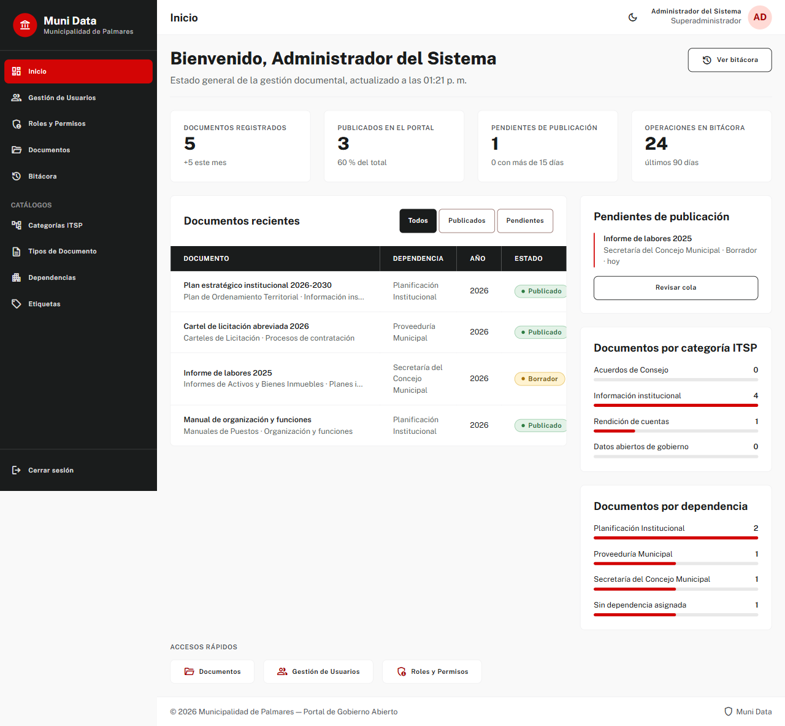

*Figura 3. Página de Inicio del Superadministrador.*

El menú cambia según el rol. Por ejemplo, una persona con rol Administrador no
ve **Gestión de Usuarios** ni **Bitácora**:

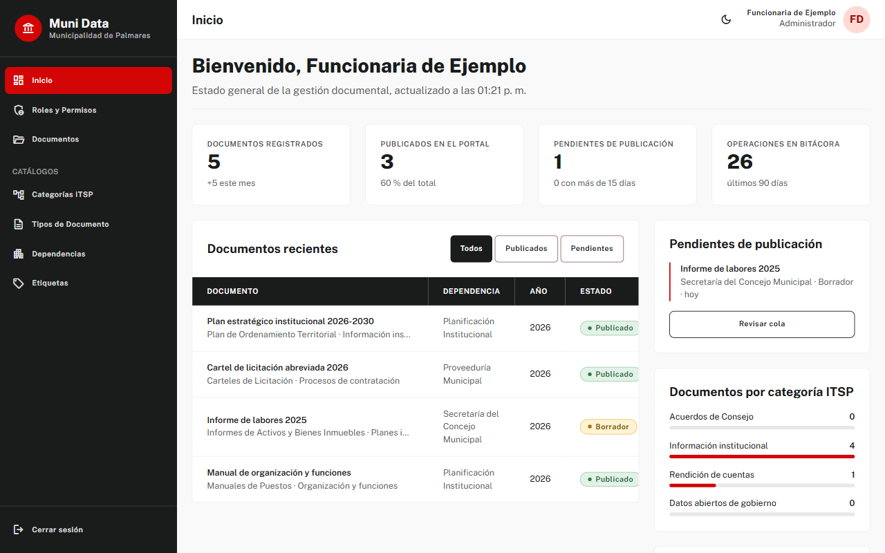

*Figura 4. Menú de una persona con rol Administrador.*

### 4.3 Modo oscuro

El botón con forma de luna, en la barra superior, cambia a **modo oscuro**;
el mismo botón, con forma de sol, regresa al **modo claro**. El sistema
recuerda su elección en ese navegador.

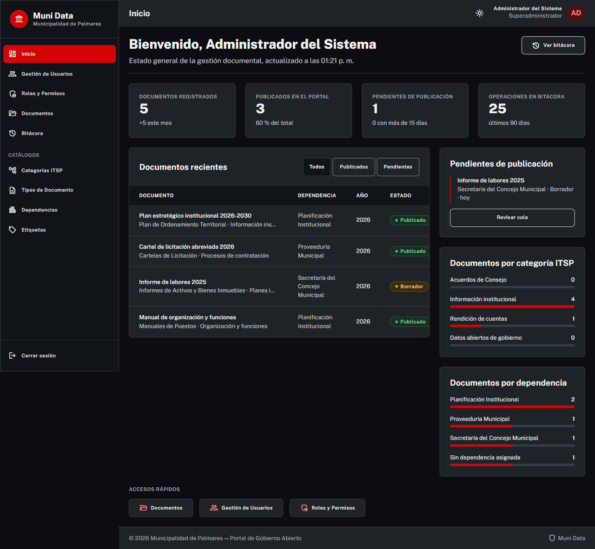

*Figura 5. La misma página en modo oscuro.*

## 5. Gestión de documentos

### 5.1 Estados de un documento

| Estado | Color | Significado |
|---|---|---|
| Borrador | Amarillo | Registrado pero no visible en el portal |
| Publicado | Verde | Visible para la ciudadanía en el portal |
| Inactivo | Rojo | Retirado; ya no se puede editar ni publicar |

Un documento publicado puede volver a **Borrador** con **Despublicar**. La
inactivación es definitiva. Ningún documento se borra: los inactivos se
conservan para consulta.

### 5.2 Lista de documentos

En **Documentos** se ven todos los documentos con su clasificación, año,
versión, estado y acciones.

- **Buscar por título o descripción:** escriba parte del título.
- **Filtros:** categoría, tipo, dependencia, año y estado.
- **Acciones de cada fila:** ver el detalle (ojo), editar (lápiz), publicar o
  despublicar, e inactivar.

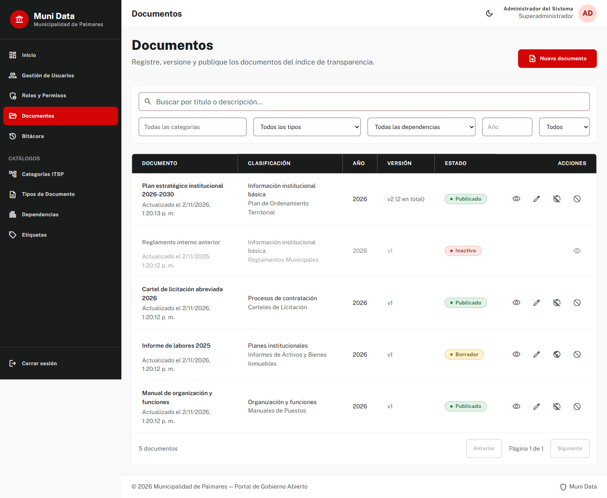

*Figura 6. Lista de documentos.*

> **Nota:** las personas con rol Usuario ven solo los documentos publicados y
> no tienen botones para modificarlos.

### 5.3 Registrar un documento

Pulse **Nuevo documento**. El registro tiene tres pasos: **Archivo**,
**Metadatos** y **Revisión**. A la derecha, el recuadro **REQUISITOS PARA
PUBLICAR** marca lo que ya está completo.

**Paso 1. Archivo**

1. Arrastre el PDF al recuadro o selecciónelo desde su computadora.
2. El sistema lo revisa. Si está bien, muestra «Validación superada: formato
   PDF permitido y tamaño dentro del límite institucional.».
3. Pulse **Continuar**.

> **Advertencia:** solo se aceptan archivos PDF de hasta 40 MB. Si el archivo
> es de otro tipo o más grande, el sistema lo rechaza y le dice el motivo.

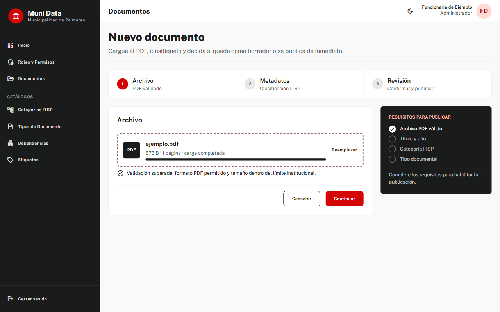

*Figura 7. Paso 1: carga del archivo.*

**Paso 2. Metadatos**

1. **Título del documento** (obligatorio).
2. **Categoría ITSP** (obligatoria): escriba parte del nombre o del código y
   elija de la lista. Se muestra la ruta completa, por ejemplo «Rendición de
   cuentas › Planes institucionales». Las categorías que no admiten
   documentos aparecen con «No disponible:» y el motivo, y no se pueden
   elegir.
3. **Tipo documental** (obligatorio) y **Año**.
4. **Dependencia**: viene precargada con la suya; puede cambiarla si registra
   en nombre de otra.
5. **Palabras clave** y **Descripción pública** (opcionales).

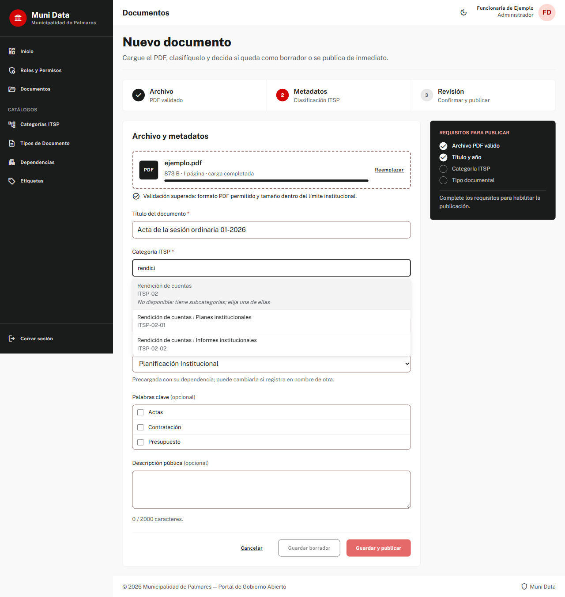

*Figura 8. Paso 2: metadatos y selección de la categoría.*

Al final del paso 2 hay tres botones:

| Botón | Qué hace |
|---|---|
| **Cancelar** | Sale sin guardar (pide confirmación si hay cambios) |
| **Guardar borrador** | Registra el documento en Borrador y sale del asistente |
| **Guardar y publicar** | Pasa al paso 3 para revisar; todavía no publica |

**Paso 3. Revisión**

Revise el resumen. Pulse **Confirmar y publicar** para registrar y publicar
el documento en una sola operación, o **Volver** para corregir algo.

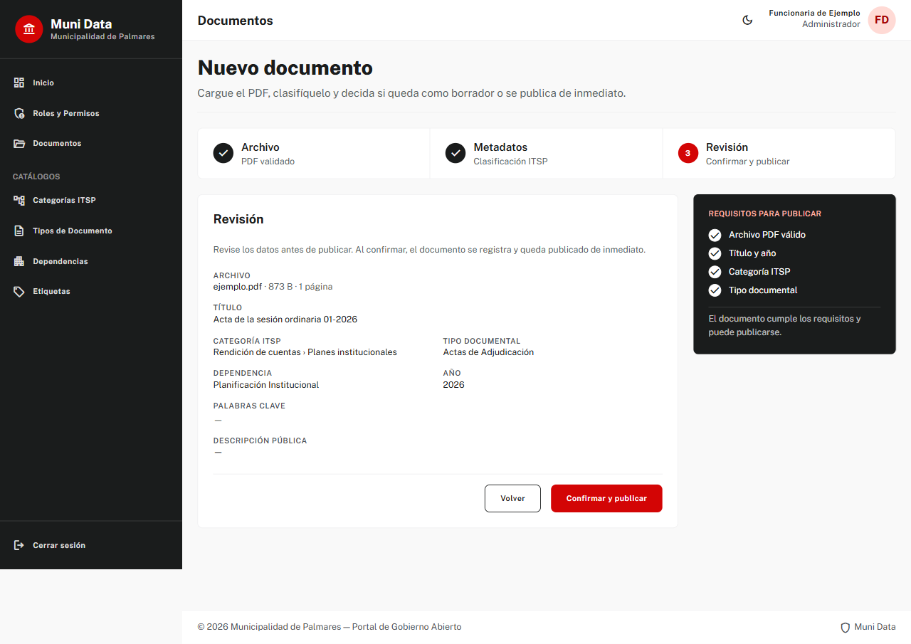

*Figura 9. Paso 3: revisión antes de publicar.*

### 5.4 Consultar un documento

Pulse el título o el ojo de un documento para ver su detalle:

- **Metadatos:** categoría, tipo, año, descripción, dependencia, etiquetas,
  quién lo registró y cuándo se publicó.
- **Vista previa:** el PDF dentro de la página. La lista de la derecha
  permite elegir qué versión ver.
- **Historial de versiones:** cada versión con su archivo, quién la cargó y
  su código de integridad (**SHA-256**). Los iconos permiten ver o descargar
  cualquier versión, no solo la vigente.

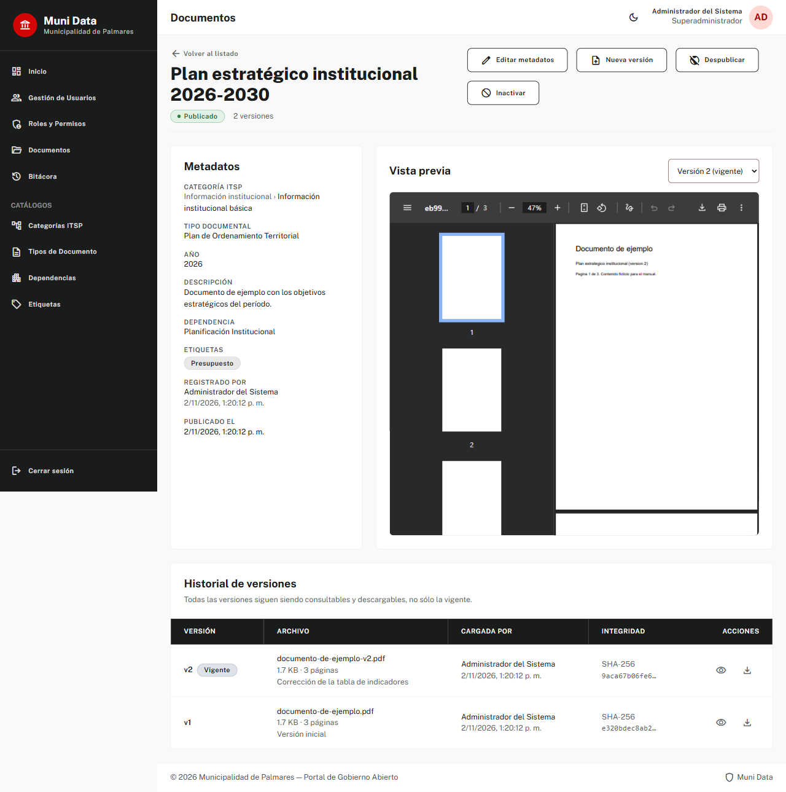

*Figura 10. Detalle de un documento con dos versiones.*

Para volver a la lista, pulse **Volver al listado**.

### 5.5 Editar los datos de un documento

En el detalle, pulse **Editar metadatos**. Puede cambiar título, descripción,
año, tipo documental, categoría, dependencia y etiquetas. Pulse **Guardar**.

Editar no cambia el archivo: para reemplazarlo hay que cargar una versión
nueva.

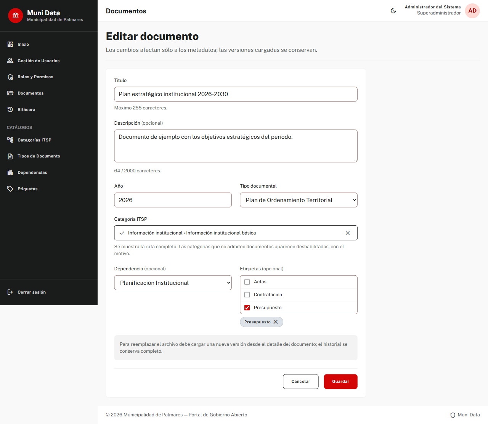

*Figura 11. Edición de los metadatos.*

### 5.6 Cargar una nueva versión

1. En el detalle, pulse **Nueva versión**.
2. Seleccione el PDF nuevo y, si quiere, escriba un **Comentario de la
   versión** (por ejemplo, qué se corrigió).
3. Pulse **Cargar versión** y confirme.

La versión anterior se conserva en el historial. El portal muestra siempre la
versión más reciente.

### 5.7 Publicar, despublicar e inactivar

Desde el detalle o desde la lista:

| Botón | Disponible cuando | Resultado |
|---|---|---|
| **Publicar** | El documento está en Borrador | Pasa a Publicado y aparece en el portal |
| **Despublicar** | El documento está Publicado | Vuelve a Borrador y sale del portal |
| **Inactivar** | Borrador o Publicado | Pasa a Inactivo de forma definitiva |

Antes de cada cambio, el sistema pregunta «¿Confirma que desea …?». Al
terminar, muestra un aviso, por ejemplo «El documento se publicó
correctamente.».

## 6. Catálogos

Los catálogos son las listas con las que se clasifican los documentos. Los
administra quien tenga el rol Superadministrador o Administrador.

### 6.1 Categorías ITSP

Las categorías siguen el Índice de Transparencia del Sector Público. Pueden
tener subcategorías, hasta 10 niveles. La lista muestra cada categoría con
sangría según su nivel, su **CÓDIGO**, su **NIVEL** («Raíz», «Nivel 2», …) y
su **ESTADO**.

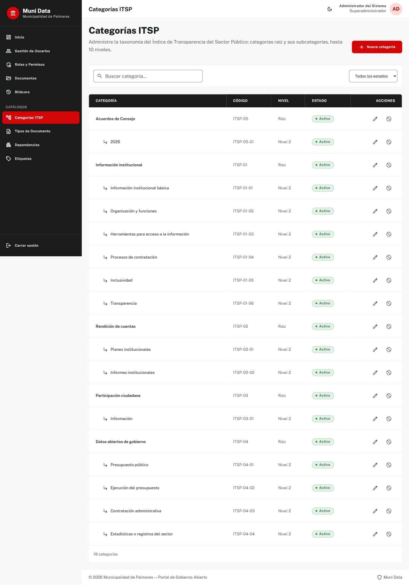

*Figura 12. Categorías ITSP.*

**Crear una categoría**

1. Pulse **Nueva categoría**.
2. Escriba el **Nombre de la categoría**.
3. En **Categoría padre**, déjela vacía para crear una categoría raíz, o
   escriba y elija la categoría bajo la cual irá la nueva.
4. Si quiere, ajuste el **Orden de despliegue** (menor número, aparece
   primero) y la descripción.
5. Pulse **Guardar** y confirme.

El **Código** no se escribe: el sistema lo asigna automáticamente y muestra
el previsto, por ejemplo «ITSP-06» o, para una subcategoría, el código de la
superior más dos cifras.

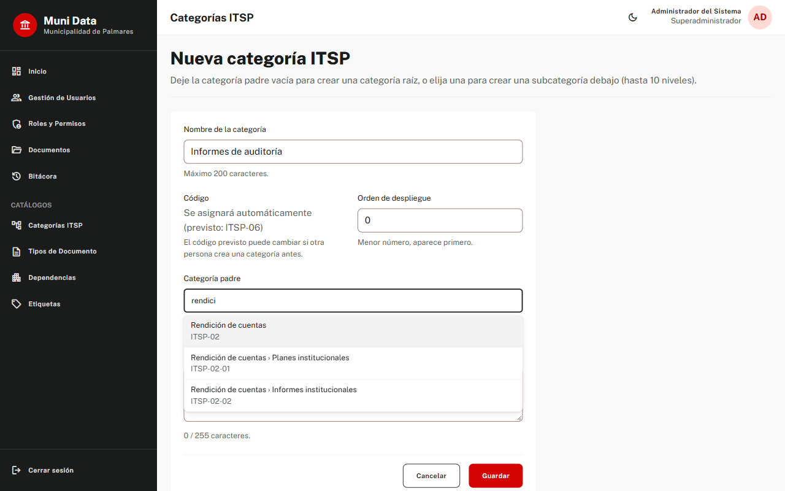

*Figura 13. Nueva categoría ITSP.*

**Mover una categoría**

Al editar una subcategoría puede elegir otra categoría padre. Antes de
guardar, el sistema avisa cuántas direcciones públicas cambiarán, porque se
renuevan el código de esa categoría y los de todas las que dependen de ella.

> **Advertencia:** si alguna de esas categorías estaba enlazada desde el sitio
> web municipal, avise al personal de TI para que actualice el enlace.

Una categoría raíz no puede pasar a ser subcategoría, ni al revés.

**Inactivar una categoría**

El botón de inactivar de cada fila la retira. Sus subcategorías se ven
inactivas «por una categoría superior», aunque conservan su propio estado;
al reactivar la superior vuelven a verse activas.

> **Nota:** la categoría **Participación ciudadana** y sus subcategorías no
> admiten documentos.

### 6.2 Tipos de Documento, Dependencias y Etiquetas

Los tres catálogos funcionan igual:

- **Tipos de Documento:** los tipos con los que se clasifican los documentos
  (actas, informes, reglamentos, etc.).
- **Dependencias:** las áreas o departamentos que originan los documentos.
- **Etiquetas:** palabras clave para encontrar documentos.

Pulse **Nuevo registro** para crear uno, el lápiz para editarlo y el botón
de inactivar para retirarlo. Un registro inactivo ya no se ofrece al
registrar documentos, pero los documentos que ya lo usan no cambian.

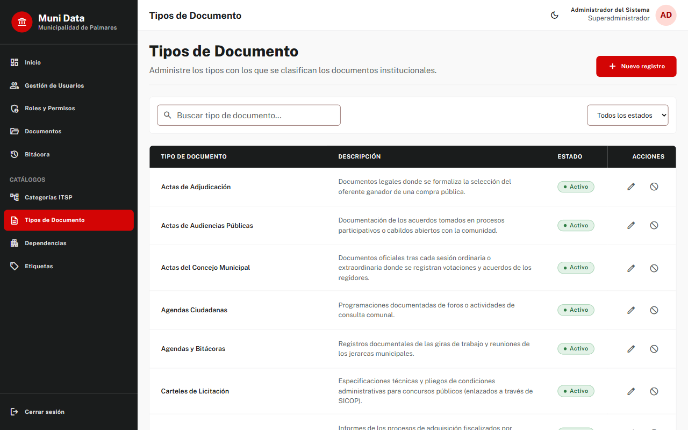

*Figura 14. Catálogo de tipos de documento.*

## 7. Usuarios, roles y permisos

Este capítulo es para el rol Superadministrador.

### 7.1 Gestión de Usuarios

En **Gestión de Usuarios** se ven todas las cuentas con su nombre, correo,
rol y estado. Puede buscar por nombre, correo o rol, y filtrar por rol y por
estado.

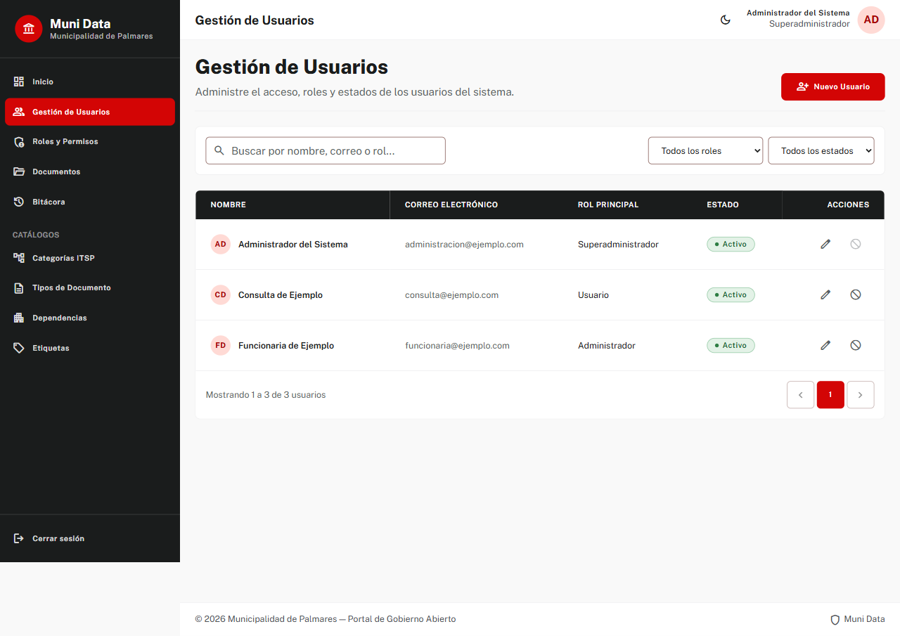

*Figura 15. Gestión de Usuarios (cuentas ficticias de ejemplo).*

**Crear un usuario**

1. Pulse **Nuevo Usuario**.
2. Complete **Nombre completo**, **Identificación** (sin guiones ni
   espacios), **Correo institucional** y **Contraseña temporal**.
3. Si corresponde, elija la **Dependencia**: se precargará en los documentos
   que registre esa persona.
4. Elija el **Rol asignado**. A la derecha se ven los permisos del rol.
5. Pulse **Crear usuario**.

Entregue la contraseña temporal a la persona por un medio seguro. Podrá
cambiarla después desde **Olvidé mi contraseña**.

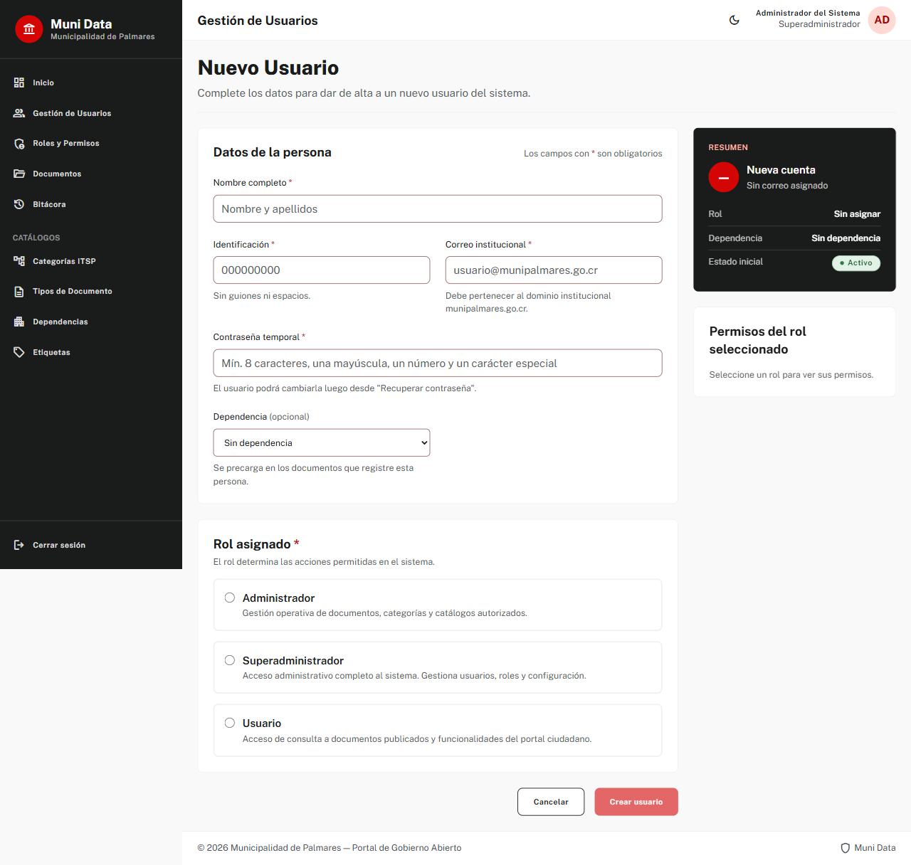

*Figura 16. Nuevo usuario.*

**Editar o inactivar**

El lápiz abre el formulario de edición, donde también se cambia el rol. El
botón de inactivar impide que la cuenta ingrese; se puede reactivar después.
Usted no puede inactivar su propia cuenta ni cambiar su propio rol.

### 7.2 Roles y Permisos

En **Roles y Permisos**, elija un rol a la izquierda para ver su **Matriz de
Permisos**, agrupada por módulo. Para cambiarla, marque o desmarque los
permisos y pulse **Guardar Cambios**; **Descartar Cambios** deshace lo que no
ha guardado.

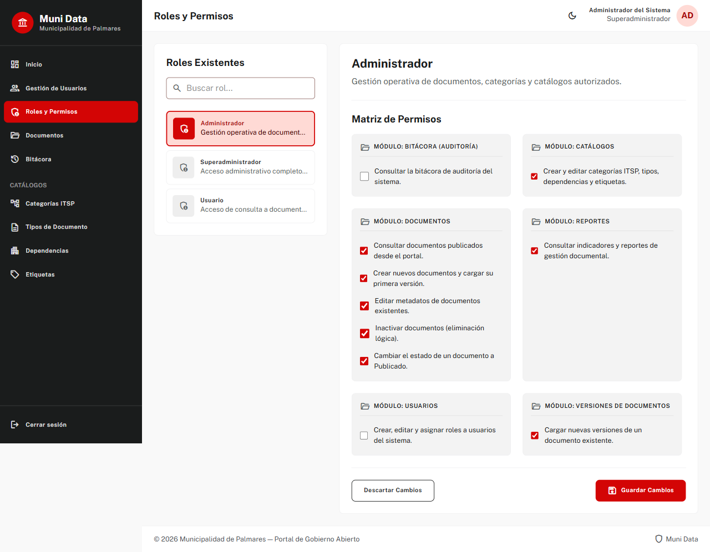

*Figura 17. Roles y Permisos.*

> **Advertencia:** solo el Superadministrador puede guardar cambios en los
> permisos. Los demás roles pueden ver la matriz, pero no modificarla.

## 8. Bitácora

La **Bitácora** registra quién hizo qué, sobre qué registro y cuándo: inicios
y cierres de sesión, intentos fallidos, creación y cambios de documentos,
versiones, descargas, usuarios, permisos y catálogos.

Puede filtrar por **USUARIO QUE EJECUTÓ LA ACCIÓN**, **TIPO DE ENTIDAD
AFECTADA**, **REGISTRO AFECTADO** y **ACCIÓN**.

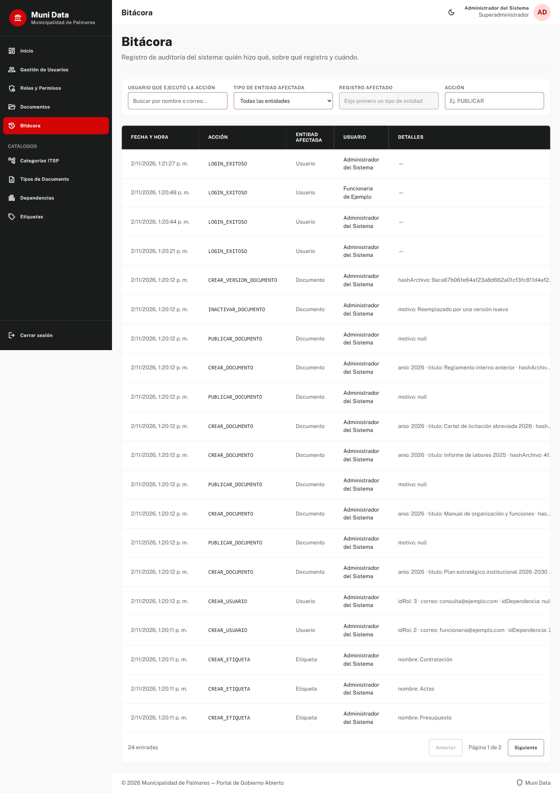

*Figura 18. Bitácora.*

> **Nota:** la bitácora conserva los registros de los últimos 3 meses. Los más
> antiguos se eliminan automáticamente el primer día de cada mes. Si necesita
> conservar un periodo, solicite al personal de TI que lo respalde antes.

## 9. Portal público de transparencia

El portal es la parte de Muni Data que ve la ciudadanía, sin cuenta, dentro
de las páginas del menú **Transparencia** del sitio web municipal. Solo
muestra documentos **Publicados**.

### 9.1 Secciones

La portada muestra las secciones del índice. Cada recuadro indica cuántos
documentos tiene.

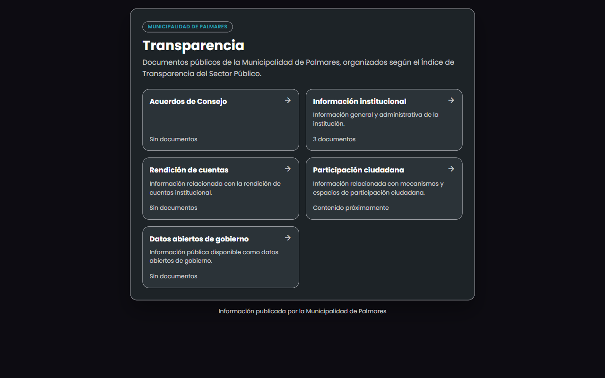

*Figura 19. Portada del portal de transparencia.*

### 9.2 Subsecciones

Al abrir una sección aparecen sus subsecciones. La etiqueta sobre el título
indica dónde está la persona.

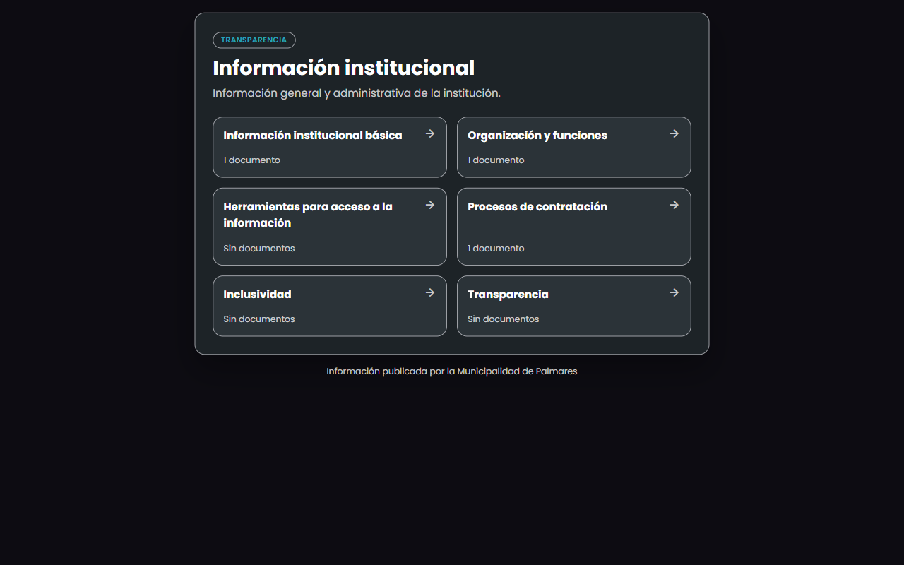

*Figura 20. Una sección con sus subsecciones.*

### 9.3 Ver y descargar documentos

En una subsección aparece la lista de documentos con su título, descripción,
etiquetas, dependencia, fecha de publicación, páginas y tamaño.

- **Ver** abre el PDF en una pestaña nueva.
- **Descargar** guarda el PDF en la computadora.

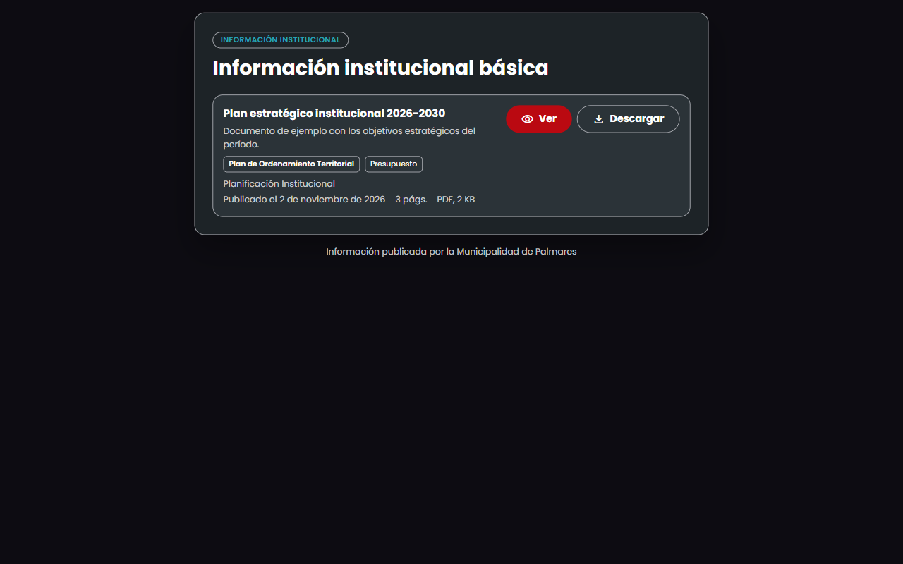

*Figura 21. Documentos publicados en una subsección.*

> **Nota:** la sección **Participación ciudadana** muestra «Contenido
> próximamente»: su contenido se administra desde el sitio web municipal.

## 10. Preguntas frecuentes

**¿Por qué no veo una opción del menú?**
Su rol no tiene ese permiso. Consulte con la persona administradora.

**Publiqué un documento y no aparece en el portal.**
Confirme que su estado es Publicado y que su categoría está activa. Si una
categoría superior está inactiva, el documento tampoco se muestra.

**¿Puedo borrar un documento?**
No. Puede inactivarlo, y queda guardado para consulta interna.

**Me equivoqué de archivo.**
Cargue una nueva versión desde el detalle del documento. La anterior queda
en el historial.

**¿Por qué no puedo elegir una categoría?**
La lista lo explica después de «No disponible:». Por ejemplo, Participación
ciudadana no admite documentos, y una categoría raíz con subcategorías pide
elegir una de ellas.

**¿Cada cuánto debo volver a ingresar?**
La sesión dura como máximo 8 horas.

## 11. Mensajes de error comunes

| Mensaje | Qué significa | Qué hacer |
|---|---|---|
| «Correo o contraseña incorrectos» | Datos de ingreso equivocados | Revíselos o use **Olvidé mi contraseña** |
| «Cuenta bloqueada temporalmente. Intente nuevamente en N minutos» | Varios intentos fallidos | Espere el tiempo indicado |
| «Debe verificar su correo electrónico antes de iniciar sesión» | Correo sin verificar | Abra el enlace de verificación recibido |
| «El enlace de recuperación no es válido o ha expirado» | El enlace venció o ya se usó | Solicite otro |
| «No tiene permisos para realizar esta acción» | Su rol no lo permite | Consulte con la persona administradora |
| «El archivo supera el tamaño máximo permitido de 40 MB» | PDF demasiado grande | Reduzca el archivo |
| «El archivo debe tener extensión .pdf» | No es un PDF | Convierta el documento a PDF |
| «El correo ya se encuentra registrado» | Ya existe una cuenta con ese correo | Busque la cuenta existente |
| «Demasiadas solicitudes, espere un momento» | Muchas consultas seguidas | Espere un minuto |
| «Esta sección no está disponible» (portal) | La sección no existe o está inactiva | Use **Ver todas las secciones** |

## 12. Glosario

| Término | Significado |
|---|---|
| Bitácora | Registro de las acciones realizadas en el sistema |
| Borrador | Documento registrado que todavía no se publica |
| Catálogo | Lista de valores para clasificar documentos |
| Categoría ITSP | Clasificación según el Índice de Transparencia del Sector Público |
| Dependencia | Área o departamento municipal que origina un documento |
| Etiqueta | Palabra clave asociada a un documento |
| Inactivo | Documento o registro retirado, que se conserva sin borrarse |
| Metadatos | Datos que describen un documento: título, año, categoría, etc. |
| Portal de transparencia | Páginas públicas donde la ciudadanía consulta documentos |
| Publicado | Documento visible en el portal |
| Rol | Conjunto de permisos asignado a una cuenta |
| SHA-256 | Código que permite comprobar que un archivo no fue alterado |
| Versión | Cada archivo PDF cargado para un mismo documento |
